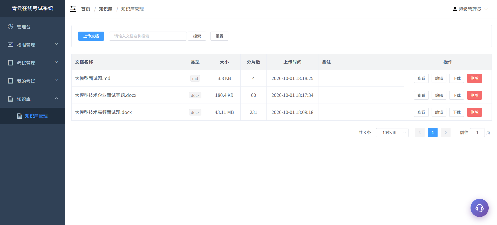
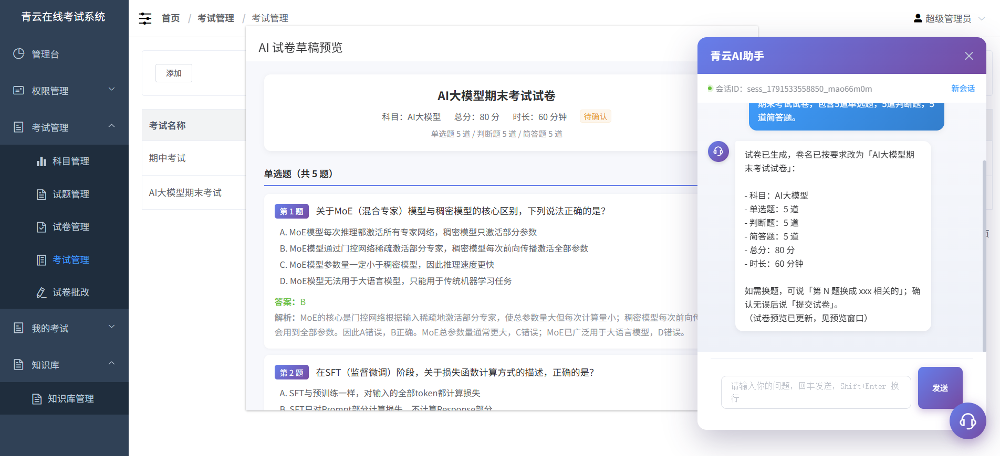
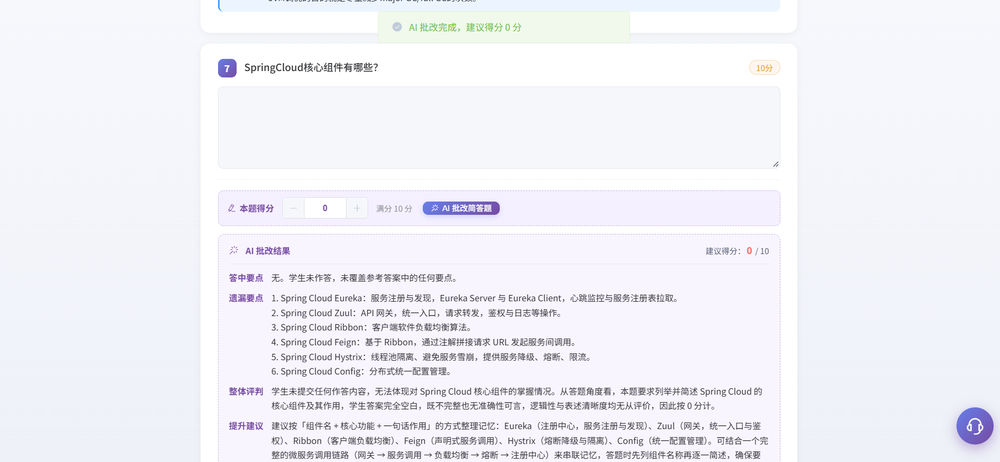
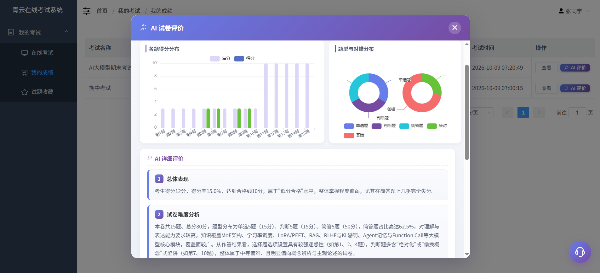
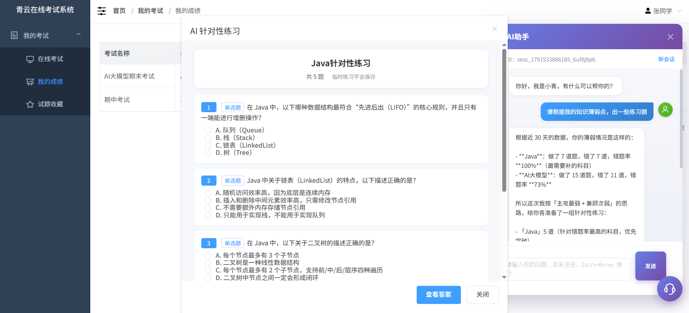
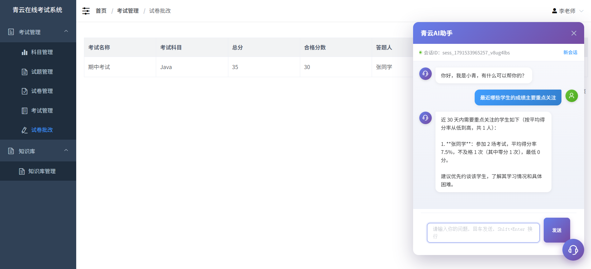

# 青云在线考试系统 

##（源代码+12000字文档+ppt）

## 项目简介

青云智能考试系统在传统题库管理、组卷、考试、阅卷、成绩统计等核心功能的基础上，深度融合大语言模型 与 RAG（检索增强生成）技术，打造出会出题、会阅卷、会分析、会辅导的 AI 辅助能力。 
系统覆盖教师、学生、管理员三类角色：教师通过自然对话即可完成命题组卷与考试编排，学生获得个性化错题讲解与针对性练习，管理员实现全流程数据管控。区别于市面上"套壳问答"式的 AI 应用，本系统让大模型真正成为能操作业务数据、能闭环执行任务的智能体 ，AI 能力贯穿"教—学—考—评"全链路。 
视频介绍：<a href="https://www.bilibili.com/video/BV1mMpx6VEyD/?spm_id_from=333.1387.homepage.video_card.click" target="_blank">点击查看B站视频介绍</a>

## 毕设代做

如果有小伙伴需要毕设代做，可以关注本人的同名公众号。 

也可以直接添加本人的微信。 

## 技术栈

| 层级 | 技术选型 |
|------|---------|
| 前端 | Vue 2.6 + Element UI + Axios + marked.js |
| 后端 | Spring Boot 2.7 + Spring AI 2.0 + MyBatis |
| 数据库 | MySQL 8.0 |
| 大模型 | DeepSeek（对话主模型） |
| 向量库 | Spring AI SimpleVectorStore（本地持久化，零外部依赖） |
| 文档解析 | Apache Tika 3.3.1 + POI 5.5.1 |
| Embedding | bge-m3（向量嵌入） |
| 部署 | JDK 21，前后端分离部署 |

## 功能介绍

### 1. 基础核心功能
- **题库管理**：支持单选题、判断题、简答题等多题型，按科目分类管理
- **试卷管理**：手动选题组卷，支持试卷预览与编辑
- **考试管理**：支持公开考试与口令考试两种模式，可设置时长、及格线
- **在线答题**：倒计时、自动交卷、答案记录
- **成绩管理**：客观题自动判分，简答题人工批阅，成绩查询与统计

### 2. AI 知识库
- 支持 Word、Excel、PPT、PDF、TXT、Markdown、JSON、HTML 等多种格式文档上传
- 自动解析、分块、向量化并持久化存储
- 文档预览（仿 PDF 阅读器风格），支持替换、编辑、删除
- 作为 AI 出题与错题讲解的知识素材来源

### 3. 教师端 AI 能力：对话式驱动，零按钮交互
- **智能出题与组卷**：教师描述需求（科目、题型、数量），AI 自动检索知识库素材、分批生成题目、去重校验并实时预览。支持"第 N 题换成 xxx"精准替换，确认后一键入库，附带数据库回查验证，杜绝幻觉导致的假提交。
- **自动创建考试**：教师一句话描述考试要求，AI 自动匹配试卷、校验字段、写入考试表。信息缺失或冲突时主动追问，而非盲目执行。
- **考试成绩智能分析**：询问某场考试表现，AI 返回交卷人数、平均分、合格率、不及格名单等关键指标。
- **学情预警与重点关注**：AI 基于错题率、零分记录、成绩趋势多维度分析，输出重点关注学生名单及原因，支持精准干预。

### 4. 学生端 AI 能力：学情 Agent + 长期记忆个性化陪伴
- **学情诊断**：AI 从真实批改数据中统计错题分布、成绩走势、薄弱科目排名，帮助学生快速定位短板。
- **错题讲解（RAG 增强）**：AI 结合知识库教材片段，生成"解题思路 + 易错点 + 知识点溯源"三段式讲解，从根因上帮助学生理解而非死记答案。
- **针对性练习**：AI 基于薄弱科目自动生成临时练习，试卷式作答后自动判客观题并展示解析，练习数据不入正式题库，AI 对话中被禁止直接列出答案。
- **长期记忆**：系统持续沉淀学生画像与偏好（学习习惯、成绩水平、对话风格），注入下次对话，使 AI 记住"习惯先看解析再做题"等个体特征，提供真正个性化的陪伴。

## 项目亮点

1. **AI 原生交互，无按钮化操作**：教师不需要在页面找按钮，直接用自然语言完成命题、组卷、建考，AI 自主决策调用工具并串联多步任务，交互体验接近真人助教。

2. **RAG + Tool Calling 深度融合**：不是简单问答。出题时先检索知识库素材再生成，错题讲解时先检索教材原文再讲解，从根源抑制大模型幻觉。

3. **角色化智能体**：同一对话入口，学生看到的是"学习伙伴"，教师看到的是"教务助手"，工具集与系统提示词按角色动态挂载，权限与能力精准隔离。

4. **写操作安全闭环**：AI 不直接改正式数据。出题先存草稿、预览确认后才入库；建考需信息齐全且匹配成功才写入。兼顾智能化与教育场景的安全底线。

5. **零外部依赖的 RAG 部署**：向量库采用本地持久化方案，文档解析依赖内置于 jar，无需额外部署 Elasticsearch / Milvus 等中间件，降低部署与迁移成本。

## 项目核心功能展示

#### 1.登录页面
 
#### 2.知识库管理
 
#### 3.AI生成试卷
 
#### 4.AI批改试卷
 
#### 5.学生试卷评价
 
#### 6.针对性出题练习
 
#### 7.学情监控
 
